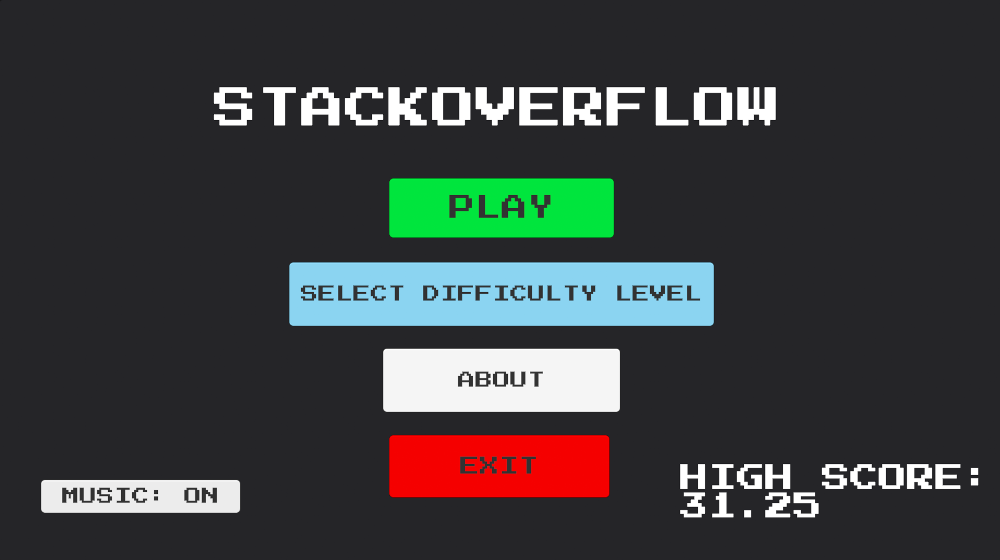
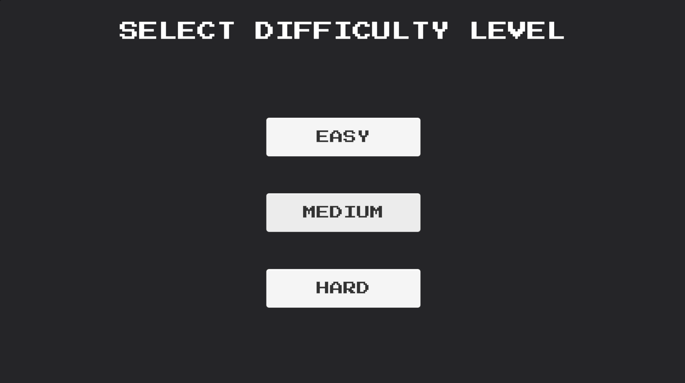
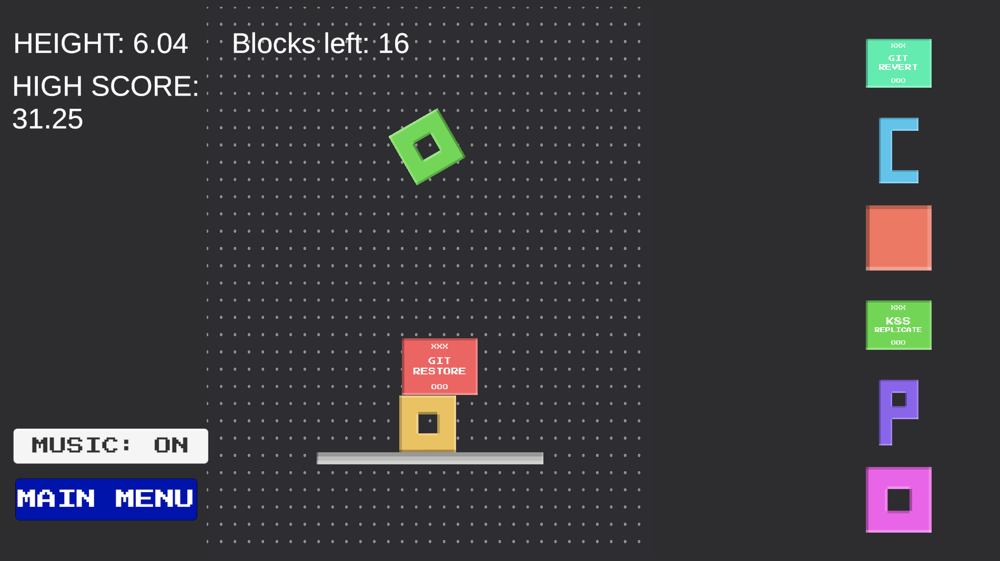
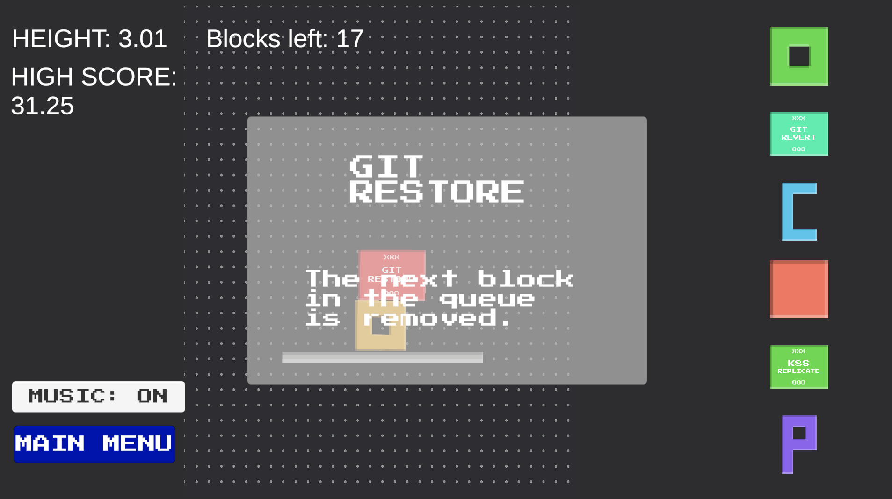
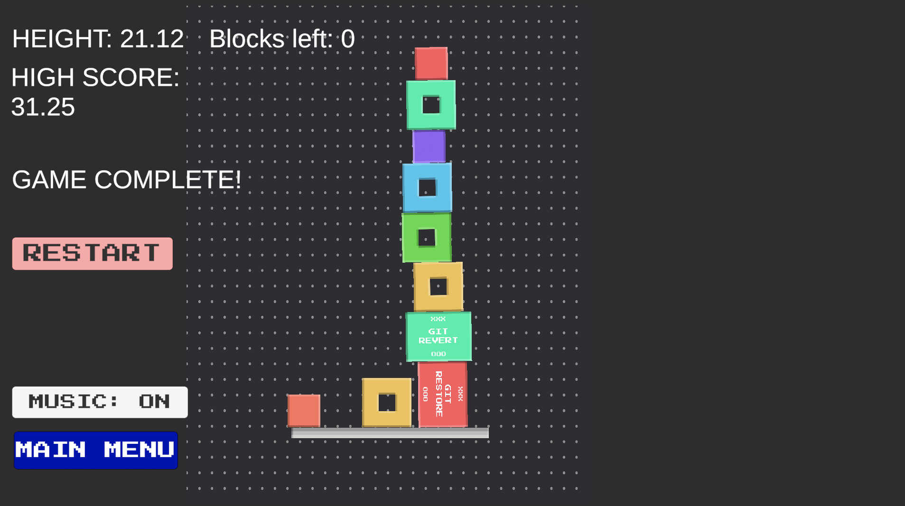

# StackOverflow

A 2D physics-based stacking game inspired by programming and software development concepts.

## Gameplay

The goal is to build the tallest possible tower by positioning and dropping falling pieces without causing the tower to collapse.

### Features

- 2D physics-based stacking
- Different block shapes
- Predefined block queues
- Increasing difficulty
- Easy, Medium, and Hard modes
- Height tracking and persistent high score
- Music toggle
- Queue display
- Special-event popups
- Restart and main menu
- Game-over tower view

## Special Blocks

- **Git Revert** — Returns the last 3 placed blocks to the queue.
- **Git Restore** — Removes the next queued block.
- **K8s Replicate** — Duplicates the next 3 blocks.
- **PyTorch Train** — Shuffles the next 3 blocks.

## Controls

- **A / D** or **Left / Right Arrow Keys** — Move the current piece
- **Space** — Drop the piece

## Screenshots

### Start Screen

### Difficulty Selection

### Gameplay

### Special Block

### Game Complete

## Development

**Game Development & Implementation:** Sarbajeet Pattadar

I handled the Unity development and implementation, including gameplay systems, physics, block queue and special-block mechanics, UI, difficulty system, persistence, camera, debugging, and integration.

**Game Concept & Design:** S. Nandesh

Developed as part of the **VIT Chennai OSPC Club**.

## Project

StackOverflow was developed as a complete Unity game with a full gameplay loop, menus, progression, persistence, and game-over flow.